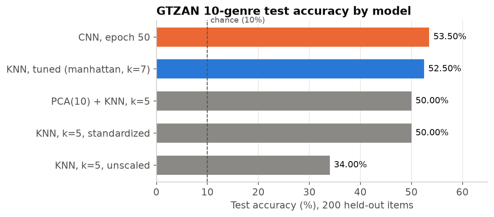
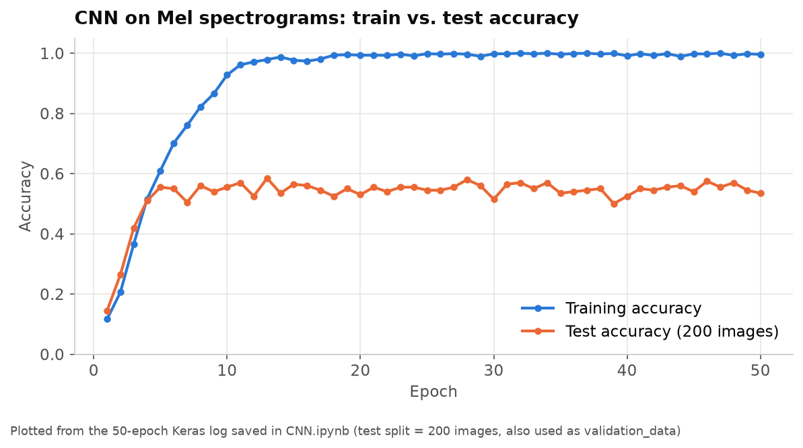
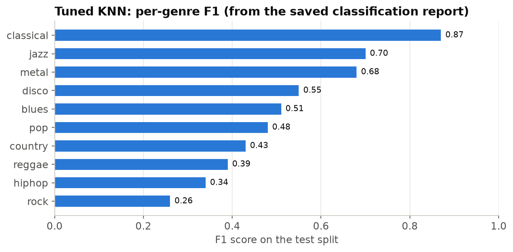
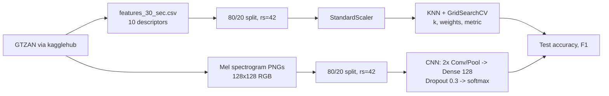

# Music Genre Classification with KNN and CNN

**Two baselines for 10-genre classification on GTZAN: a tuned KNN on audio descriptors (52.5% test accuracy) and a small Keras CNN on Mel spectrograms (53.5%). Chance is 10%.**

[](https://github.com/Akshatb848/Music-Genre-Classification-USING-KNN-and-CNN/actions/workflows/ci.yml)
[](LICENSE)
[](https://www.python.org/downloads/)


## Results at a glance

| Model | Evaluation | Accuracy |
|---|---|---|
| KNN, k=5, unscaled features | Test (200 tracks) | 34.00% |
| KNN, k=5, standardised features | Test (200 tracks) | 50.00% |
| PCA (10 comp.) + KNN, k=5 | Test (200 tracks) | 50.00% |
| **KNN, tuned** (manhattan, k=7, distance weights) | Test (200 tracks) | **52.50%** |
| KNN, tuned (same config) | 5-fold CV mean on train (800) | 59.00% |
| **CNN**, final epoch (50) | Test (200 images) | **53.50%** |

Tuned KNN on the test split: macro F1 0.52, weighted F1 0.51. All values come from the saved notebook outputs. CI re-checks them against the notebooks on every push.

<p align="center">
  
  
</p>

*Left: test accuracy by model. Right: the CNN's training accuracy stays around 0.99 to 1.00 from epoch 18 onward, while test accuracy stays between 0.50 and 0.585 from epoch 5 onward, a clear case of overfitting. The notebooks contain no plots, so these charts are drawn from numbers they printed: the accuracy lines in `KNN.ipynb` and the 50-epoch Keras log in `CNN.ipynb`.*

<details>
<summary>Tuned KNN: per-genre F1</summary>



Classical (0.87), jazz (0.70) and metal (0.68) are easiest. Rock (0.26), hip-hop (0.34) and reggae (0.39) are hardest. Values come from the classification report in `KNN.ipynb`.
</details>

## Problem

Given a 30-second music clip, predict its genre from ten classes: blues, classical, country, disco, hiphop, jazz, metal, pop, reggae, rock. The question is how far a classic distance-based model on handcrafted audio features gets compared with a small CNN on spectrogram images.

## Data

| | |
|---|---|
| Dataset | GTZAN genre collection (Tzanetakis & Cook, 2002), 10 genres × 100 thirty-second clips |
| Copy used | [Kaggle `andradaolteanu/gtzan-dataset-music-genre-classification`](https://www.kaggle.com/datasets/andradaolteanu/gtzan-dataset-music-genre-classification), downloaded with `kagglehub` |
| Licence | GTZAN has no formal licence and is widely used for non-commercial research. The audio is copyrighted music. Nothing from the dataset is redistributed here. |
| KNN input | `Data/features_30_sec.csv`: 1,000 rows × 60 precomputed descriptors (10 used) |
| CNN input | `Data/images_original/<genre>/*.png`: one Mel spectrogram per track (999 loaded; jazz has 99) |

## Approach



**KNN (`KNN.ipynb`)**
- Features: `chroma_stft_mean`, `rms_mean`, `spectral_centroid_mean`, `spectral_bandwidth_mean`, `rolloff_mean`, `zero_crossing_rate_mean`, `harmony_mean`, `perceptr_mean`, `tempo`, `mfcc1_mean`.
- Split: `train_test_split(test_size=0.2, random_state=42)`, giving 800 train and 200 test tracks (not stratified).
- Experiments: unscaled k=5, then standardised k=5, then `GridSearchCV` (5-fold) over `n_neighbors` {3…13}, `weights` and `metric`. The best configuration is `{'metric': 'manhattan', 'n_neighbors': 7, 'weights': 'distance'}`. A second, wider grid picked the same configuration. A PCA(10) + KNN variant was also tried.

**CNN (`CNN.ipynb`)**
- Input: 128×128 RGB spectrogram images scaled to [0, 1], split 80/20 into 799 train and 200 test images.
- Architecture: Conv2D(32) → MaxPool → Conv2D(64) → MaxPool → Flatten → Dense(128) → Dropout(0.3) → Dense(10, softmax).
- Training: Adam, categorical cross-entropy, 50 epochs, batch size 32. No augmentation and no early stopping.

## Reproduce

Tested with Python 3.11. The notebooks ran on Kaggle with TensorFlow 2.18.0, and `requirements.txt` pins those versions.

```bash
git clone https://github.com/Akshatb848/Music-Genre-Classification-USING-KNN-and-CNN.git
cd Music-Genre-Classification-USING-KNN-and-CNN
python3.11 -m venv .venv && source .venv/bin/activate   # Windows: .venv\Scripts\activate
pip install -r requirements.txt
jupyter notebook
```

Run order: `KNN.ipynb` (fast, CPU), then `CNN.ipynb` (about 50 epochs; a GPU helps).

- **On Kaggle (easiest):** attach the dataset `andradaolteanu/gtzan-dataset-music-genre-classification`. The hard-coded `/kaggle/input/...` paths then work as they are.
- **Locally:** set Kaggle credentials (`~/.kaggle/kaggle.json` or `KAGGLE_USERNAME` / `KAGGLE_KEY`, and never commit them). Run the `kagglehub.dataset_download(...)` cell, then replace `/kaggle/input/gtzan-dataset-music-genre-classification` with the printed path (`dataset_path` in `KNN.ipynb`, `image_dir` in `CNN.ipynb`). The `!pip install` cells at the top of `KNN.ipynb` are not needed once `requirements.txt` is installed.

Smoke checks (no data or training needed). These are the same checks CI runs:

```bash
pip install pytest nbformat
pytest -q tests
python scripts/make_figures.py   # redraw the README charts from the saved notebook outputs
```

## Repository structure

```
.
├── KNN.ipynb                 # descriptor-based KNN: baseline, scaling, GridSearchCV, PCA variant
├── CNN.ipynb                 # spectrogram CNN (Keras)
├── docs/images/              # charts drawn from numbers printed in the notebooks
├── scripts/make_figures.py   # redraws those charts from the saved notebook outputs (no training)
├── tests/test_notebooks.py   # CI smoke checks: nbformat validity + README numbers match notebook outputs
├── requirements.txt
├── .github/workflows/ci.yml
└── LICENSE
```

## Limitations

- **Small data, single split.** About 1,000 tracks with 200 in each test set, so one test example equals 0.5 percentage points. There are no repeated splits or confidence intervals, and the split is not stratified.
- **The test set doubles as the CNN's validation set** (`validation_data=(X_test, y_test)`). The reported number is from the final epoch, not one selected on the test set, but there is no separate validation split.
- **KNN variants were compared on the same test split.** The 59.00% figure is CV accuracy on the training data, even though the notebook labels it "Accuracy of Best KNN model".
- **The PCA step reduces nothing.** It keeps 10 components of 10 features, and it reuses an untuned k=5 KNN.
- **Not exactly reproducible.** No TensorFlow seed is set. In `KNN.ipynb`, one cell uses `PCA` before the cell that imports it.
- **GTZAN has known issues** (repeated artists, duplicated or mislabelled clips). A random split ignores them, so scores may be optimistic.

## Next steps

1. Use an artist-filtered split (for example, the Sturm "fault-filtered" partition), a separate validation split, and repeated stratified CV with mean ± std.
2. Train on 3-second segments and aggregate predictions per track, keeping all segments of a track in the same fold to prevent leakage.
3. Strengthen the CNN with SpecAugment, batch norm, early stopping on validation loss, and a seed.
4. Try transfer learning from pretrained audio embeddings (for example, PANNs or YAMNet) with a linear head.
5. Add a confusion matrix to see which genres get confused (rock vs. country vs. blues are the likely candidates).

## License

Code: [MIT](LICENSE) © 2026 Akshat Banga. GTZAN audio and derived files are not redistributed.

## Author

**Akshat Banga**, AI Generalist and AI transformation. [GitHub](https://github.com/Akshatb848) · [LinkedIn](https://www.linkedin.com/in/akshat-banga-6574aa170/)
